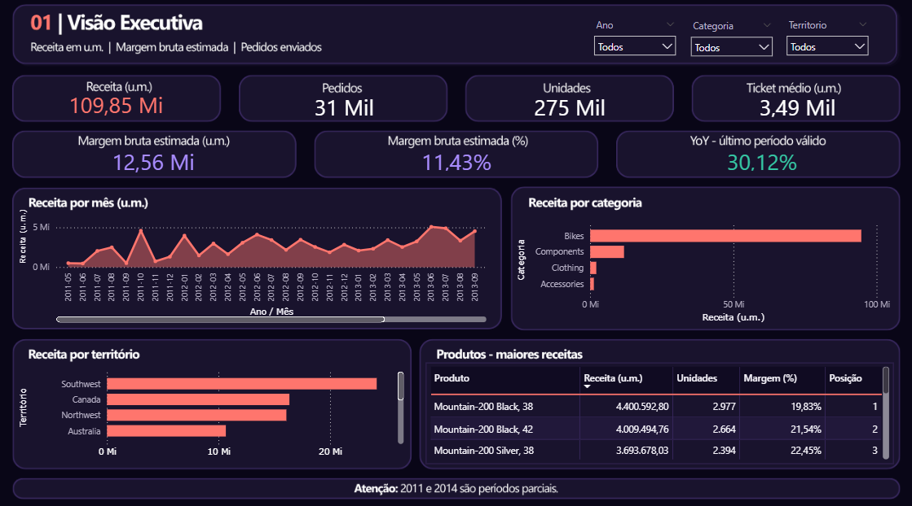
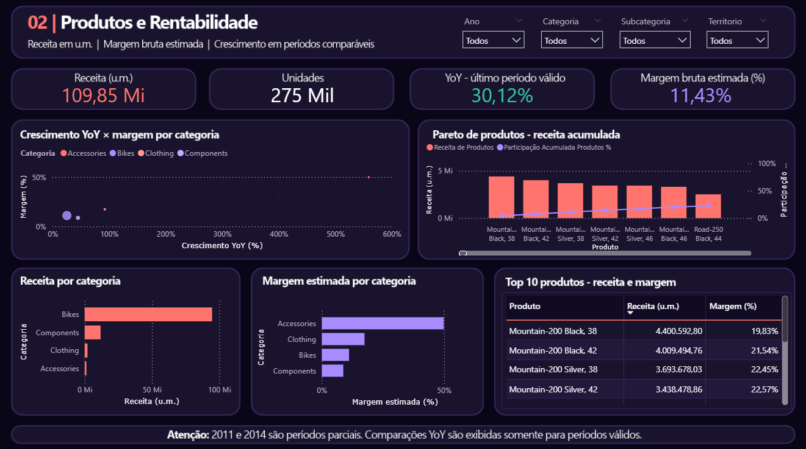
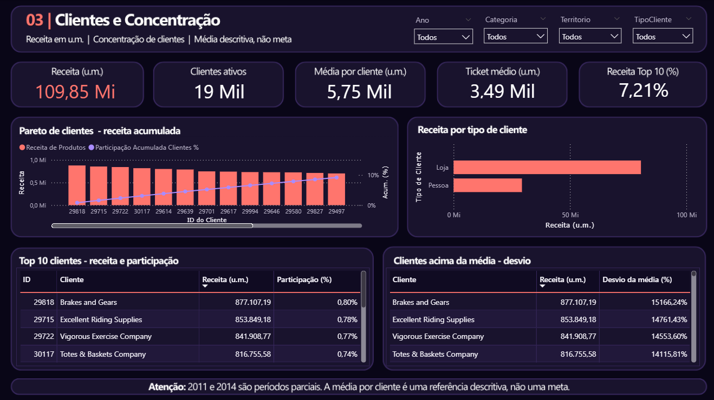
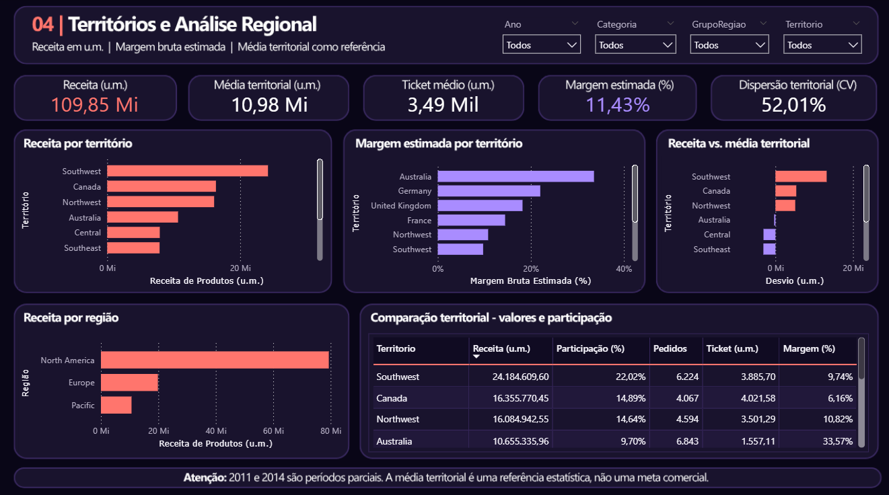
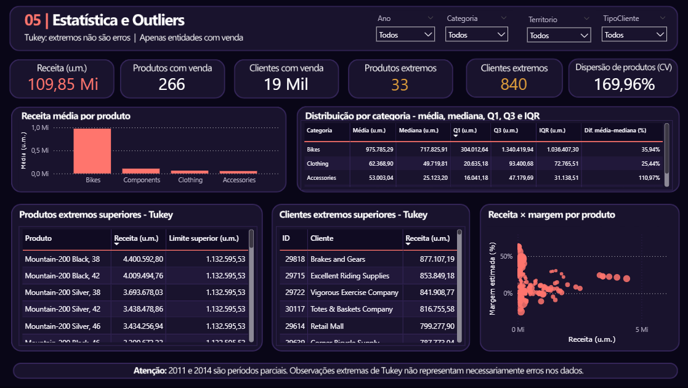

# AdventureWorks - Dashboard de Vendas, Rentabilidade e Concentração

Projeto de Business Intelligence construído sobre o AdventureWorks2022 para analisar desempenho comercial, concentração de receita, rentabilidade estimada, diferenças territoriais e observações estatisticamente extremas. A entrega combina camada analítica em SQL Server, modelo dimensional, medidas DAX, cinco páginas no Power BI e conciliação documentada entre SQL e DAX.



## Em 30 segundos

| Aspecto | Evidência no repositório |
|---|---|
| Problema | Transformar a base transacional AdventureWorks2022 em uma visão confiável de vendas, rentabilidade estimada, concentração e desempenho territorial. |
| Solução | Camada analítica em SQL Server, modelo dimensional, Power Query, medidas DAX e dashboard de cinco páginas no Power BI. |
| Resultados | 80% da receita está concentrada em 1.607 clientes (8,41%) e 64 produtos (24,06%); Southwest representa 22,02% da receita. |
| Validação | A execução registrada comparou SQL e DAX em 4.782 pontos sem divergências no conjunto testado; esta revisão documental não reexecutou os testes. |
| Entregáveis | PBIX canônico, 23 scripts SQL, snapshot TMDL auditável, documentação de regras, mapeamentos, validação e insights. |

## Resumo executivo

O dashboard responde a perguntas de gestão sem confundir descrição estatística com causalidade ou meta. O universo padrão considera pedidos enviados, linhas com receita positiva e quantidade positiva. A receita representa itens após desconto, sem impostos e frete; valores monetários são apresentados em `u.m.` porque a base não autoriza inferir moeda real.

O arquivo canônico é [`AdventureWorks_Dashboard.pbix`](AdventureWorks_Dashboard.pbix). As cinco páginas estão concluídas e foram verificadas com dados carregados; Top 10, Paretos, YoY, filtros, tooltips e a página estatística foram validados. Na revisão final não houve visual em carregamento indefinido.

## Problema de negócio

A base transacional contém vendas, clientes, produtos, territórios e histórico de custos, mas não oferece diretamente uma visão executiva consistente. O projeto organiza essas entidades para permitir:

- acompanhar receita, pedidos, unidades, ticket e margem bruta estimada;
- identificar concentração de receita em clientes e produtos;
- comparar territórios sem transformar a média em meta comercial;
- analisar crescimento apenas em períodos comparáveis;
- localizar extremos de Tukey sem classificá-los automaticamente como erros.

## Perguntas analíticas

- Como receita, volume, ticket e margem estimada evoluem no período?
- Quais produtos, categorias, clientes e territórios concentram receita?
- Quantos clientes e produtos são necessários para atingir 80% da receita?
- Como receita e margem estimada se relacionam entre categorias e produtos?
- Quais territórios estão acima ou abaixo da média descritiva?
- Quais entidades ultrapassam os limites superiores de Tukey?

## Arquitetura

```text
SQL Server -> views analíticas -> Power Query -> modelo dimensional -> DAX -> Power BI
```

As views analíticas fornecem a fato de vendas e as dimensões de cliente, produto e território importadas pelo Power Query. A view `vw_DimCalendario` apoia consultas e validações SQL, enquanto o calendário ativo do modelo Power BI é uma tabela calculada em DAX. O modelo utiliza relacionamentos muitos-para-um, com filtragem unidirecional das dimensões para a tabela fato. O manifesto em [`powerbi/Model/`](powerbi/Model/) é um snapshot textual auditável, não um projeto PBIP completo; seu escopo e estado de sincronização estão descritos no [`README do modelo`](powerbi/Model/README.md).

## Regras analíticas essenciais

- Universo padrão: `Status = 5`, `LineTotal > 0` e `OrderQty > 0`.
- Receita: soma de `LineTotal`, após desconto da linha, sem impostos e frete.
- Custo: custo histórico vigente na data do pedido, com `StandardCost` atual como fallback explícito.
- Margem bruta: estimativa de receita menos custo utilizado.
- Períodos: 2011 e 2014 são parciais; o YoY é exibido apenas quando há período comparável válido.
- Estatística: população completa disponível, com `STDEVP` e `VARP` quando aplicável.
- Tukey: extremo estatístico não significa erro de dados.
- Moeda: valores monetários em `u.m.`, sem alegação de reais, dólares ou outra moeda.

Detalhes estão em [`docs/regras_de_negocio.md`](docs/regras_de_negocio.md) e [`docs/dicionario_medidas_dax.md`](docs/dicionario_medidas_dax.md).

## As cinco páginas

### 01 - Visão Executiva

Consolida receita, pedidos, unidades, ticket, margem estimada, YoY válido, evolução mensal e rankings de categoria, território e produto.


### 02 - Produtos e Rentabilidade

Relaciona crescimento YoY e margem estimada por categoria, apresenta Pareto de produtos, comparação por categoria e Top 10 por receita. O cartão "YoY - último período válido" fica em branco para 2011, 2012 e 2014 e mostra 30,12% para 2013 e para "Todos".



### 03 - Clientes e Concentração

Mostra participação do Top 10, Pareto limitado visualmente aos 20 principais clientes, tipo de cliente e desvios em relação à média. O denominador da participação acumulada permanece no universo selecionado, não apenas nos 20 exibidos.



### 04 - Territórios e Análise Regional

Compara receita, margem estimada, ticket, dispersão e desvio em relação à média territorial. A média é referência estatística, não meta automática.



### 05 - Estatística e Outliers

Apresenta distribuição por categoria, média, mediana, quartis, IQR, coeficiente de variação, extremos superiores de Tukey e dispersão entre receita e margem estimada. A categoria está disponível no tooltip da dispersão.



## Principais insights comprovados

As consultas e os resultados documentados sustentam estes achados:

- 1.607 de 19.119 clientes ativos, ou 8,41%, acumulam 80% da receita.
- 64 de 266 produtos vendidos, ou 24,06%, acumulam 80% da receita.
- Southwest lidera a receita com 24.184.609,60 u.m., equivalentes a 22,02% do total.
- Australia registra mais pedidos que Southwest, mas ticket médio menor: 1.557,11 u.m. contra 3.885,70 u.m.
- Components cresceu 44,64% em receita de 2012 para 2013, enquanto sua margem bruta estimada em valor caiu.

Esses resultados são descritivos: concentração não comprova risco ou fidelidade, associação não comprova causa e margem estimada não equivale a lucro contábil. A fundamentação completa está em [`docs/insights_comerciais.md`](docs/insights_comerciais.md).

## Design e semântica visual

A identidade final é escura, com fundo roxo profundo, superfícies violetas, coral para receita e séries principais e lavanda para margem estimada e comparações secundárias. Verde é reservado a resultado comprovadamente favorável; âmbar identifica extremos de Tukey. Indicadores neutros permanecem brancos.

O canvas usa 1280 x 720. A hierarquia combina cabeçalho, filtros, cartões, visuais analíticos e nota metodológica. Os wireframes em [`assets/ux-ui/wireframes/`](assets/ux-ui/wireframes/) são protótipos estruturais; as imagens em [`assets/screenshots/`](assets/screenshots/) são capturas do PBIX preenchido. Consulte [`docs/design/README.md`](docs/design/README.md).

## Validação SQL x DAX

A conciliação registrada avaliou 4.782 comparações entre resultados SQL e medidas DAX, sem divergências no conjunto executado. Os testes cobriram totais globais, anos, meses, categorias, territórios, clientes, produtos, Paretos, Top 10, estatística e contextos de filtro.

Essa evidência não foi reexecutada nesta revisão documental. Critérios, escopo e resultados permanecem registrados em [`docs/validacao_sql_dax.md`](docs/validacao_sql_dax.md).

## Tecnologias

- SQL Server e T-SQL;
- Power Query;
- modelo dimensional e TMDL para inspeção textual;
- DAX;
- Power BI Desktop;
- Git para versionamento do repositório.

## Como reproduzir a camada SQL

Pré-requisito: uma instância SQL Server com o banco `AdventureWorks2022` restaurado.

1. Execute os scripts de [`queries/01_exploracao/`](queries/01_exploracao/) e [`queries/02_qualidade/`](queries/02_qualidade/) para conhecer e verificar a base.
2. Crie as views na ordem numérica de [`queries/03_camada_analitica/`](queries/03_camada_analitica/).
3. Execute as consultas de [`queries/04_kpis/`](queries/04_kpis/), [`queries/05_analises/`](queries/05_analises/) e [`queries/06_estatistica/`](queries/06_estatistica/) conforme a análise desejada.
4. Use [`queries/07_validacao/`](queries/07_validacao/) para controles de universo, chaves, custo, dimensões e KPIs.

Os scripts analíticos são somente leitura; apenas a etapa 03 cria ou altera views. Veja a ordem detalhada em [`queries/README.md`](queries/README.md).

## Como abrir o PBIX

1. Abra [`AdventureWorks_Dashboard.pbix`](AdventureWorks_Dashboard.pbix) no Power BI Desktop.
2. Para atualizar dados, disponibilize `AdventureWorks2022` e as views analíticas na instância esperada pelo modelo ou ajuste a fonte local no Power Query.
3. Não trate o manifesto TMDL como substituto do PBIX: ele existe para inspeção e compreensão do modelo, com limitações registradas no [`README do modelo`](powerbi/Model/README.md).

O snapshot TMDL registra `localhost\SQLEXPRESS` como fonte das quatro partições importadas. Essa é uma configuração local genérica, sem credenciais; confirme a fonte ativa no PBIX e ajuste-a no Power Query quando usar outra instância.

O PBIX contém dados importados; para uma publicação real, revise governança, permissões e exposição de dados antes de usar qualquer serviço externo.

## Limitações e cuidados de interpretação

- 2011 e 2014 são períodos parciais.
- Margem bruta é estimada e depende da regra de custo histórico com fallback.
- A moeda original não foi comprovada; por isso a unidade é `u.m.`.
- Média territorial é referência descritiva, não meta.
- Extremos de Tukey merecem investigação, mas não são erros por definição.
- Concentração, crescimento e associação não demonstram causalidade.
- Barras de rolagem em tabelas preservam detalhe e não representam defeito por si só.

## Estrutura do repositório

```text
adventureworks-sales-analysis/
|-- AdventureWorks_Dashboard.pbix
|-- README.md
|-- assets/
|   |-- screenshots/          # capturas finais das cinco páginas
|   `-- ux-ui/                # wireframes e sistema visual final
|-- data/README.md
|-- docs/                     # escopo, regras, mapeamentos, validação e insights
|-- powerbi/Model/            # manifesto textual do modelo
|-- queries/                  # exploração, views, análises e validações SQL
`-- tools/README.md
```

## Estado atual

O projeto está concluído e este repositório público é sua apresentação de portfólio no GitHub. O PBIX canônico, as capturas finais, a camada SQL, o snapshot TMDL e a documentação técnica estão versionados aqui.

A publicação se limita aos artefatos do projeto no GitHub: não há URL pública do relatório no Power BI Service, e esta revisão não publica nem atualiza conteúdo nesse serviço.
